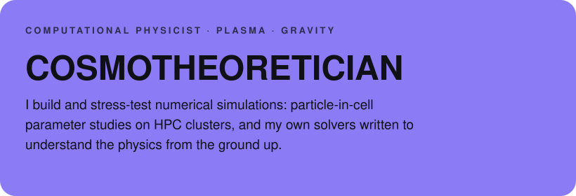
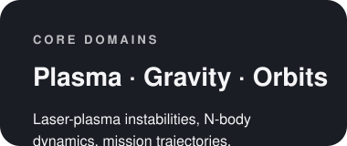
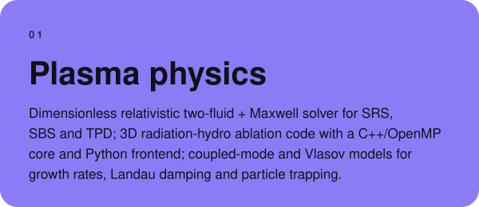
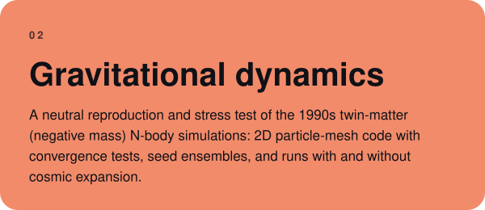
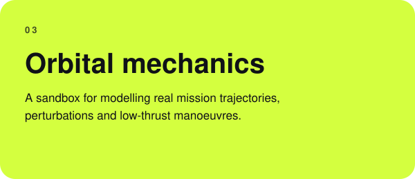
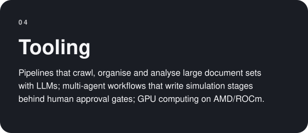

<table><tr>
<td width="68%"></td>
<td width="32%"> </td>
</tr></table>

<a href="https://github.com/CosmoTheoretician?tab=repositories">Repositories</a>

## Selected work

<table><tr>
<td width="50%"></td>
<td width="50%"></td>
</tr><tr>
<td width="50%"></td>
<td width="50%"></td>
</tr></table>

**Stack** · Python (NumPy, PyTorch) · C++ · OpenMP · pybind11 · Slurm · Linux/WSL
